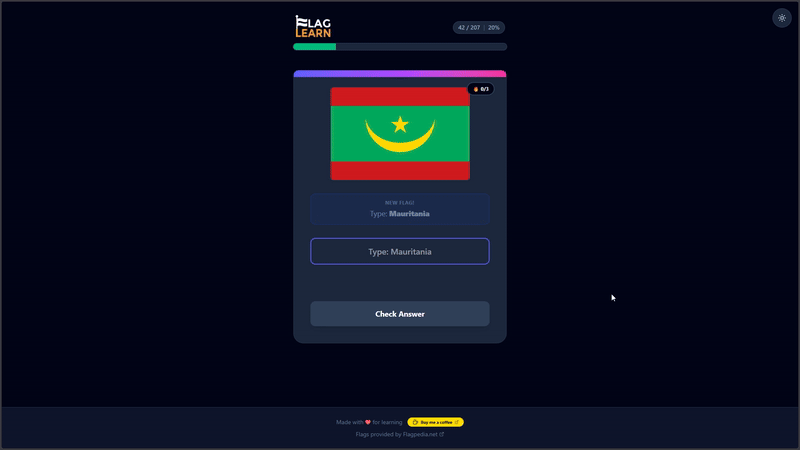

# 🌍 Flag Learn (Geography, Science & Astronomy Quiz)

An interactive educational quiz game built with React, TypeScript, and Tailwind CSS. Master world geography, flags, capitals, and even the night sky through engaging game modes and spaced repetition - or just drive a car around the world and watch the flags appear!

---



---

### 🚀 **Live Demo:** [https://www.flaglearn.eu/](https://www.flaglearn.eu/)

### 💬 **Community:** [Discord](https://discord.gg/qcwW5evMU9)

---

## ✨ Game Modes

- **📖 Single Player:** Learn World Flags, US State Flags, and World Capitals in batches of 10. Prioritizes spaced repetition.
- **💡 Daily Trivia:** Six World Trivia questions dealt from the date, the same six for everyone, one go at each - leaving or reloading during a question counts it as unanswered. The score lands in the shared "Today's Standing" panel as a share of the points on offer, the result copies out as a row of squares, and it keeps its own streak.
- **👥 Trivia Rooms:** World Trivia for a group. Open a room, share its five-letter code (or the invite link) and pick how to play: a **battle**, where everybody - the host too - answers the same question at the same time, or a **quiz night**, where the host's screen is the big screen on the TV (the question, the countdown, how many have answered) and everyone answers on their phone, with each option in the same colour and place on every screen. After every question a leaderboard shows the answer, its fact and the points landing. The host picks 5-100 questions on a slider, the region and which kinds of question are dealt, whether the next question starts on its own after the leaderboard or waits for them, and can make the room **private** (a room seats up to 100): every room is listed for everyone, but a private one is only joined with its password, which the database checks and nobody can read back.
- **📅 Daily Flagle:** A new mystery flag to guess every single day.
- **🧭 Daily Deduction:** Name the mystery country in six guesses. Every guess comes back answered on five fronts: **continent** and **region** (green for a match, amber when you have the right continent but the wrong corner of it), **population** and **area** with an arrow pointing toward the answer's, and a **compass bearing** with a closeness percentage — so even a wild opening guess tells you which way to walk. All 197 countries in the pool are legal guesses, the answer is drawn from 150 well-known ones, and the result copies out as a spoiler-free emoji grid.
- **🧩 Daily Connections:** Sixteen countries, four hidden groups of four. Sort them all with at most four mistakes — a brand new grid every day, built from regions, capitals, currencies, country names, size, and flag design.
- **🏁 Daily Rally:** Road Trip as a race. Everyone starts at the same unmarked spot on the covered world map, with no zoom-out and only three target countries named; read the flags you uncover to work out where you are, then drive to all three as fast as you can. The clock starts on your first input and keeps running through a reload, so scouting first does not pay. Every finish time lands in the shared "Today's Standing" panel.
- **🗺️ Map Locator:** Interactive SVG world map. Find the correct country by clicking on its territory.
- **🚗 Road Trip:** Drive a little 3D car around a world map that starts covered, and the flags show through wherever you have been. Real car handling - W/S to drive and brake, A/D to steer, drifts that the car slides into on its own, nitro earned from drifting - and a touch joystick on phones. Oceans are walls you bounce off; a handful of ports (Calais-Dover, Lisbon-New York, Dakar-Recife, Johor-Darwin, Kamchatka-Alaska) sail you between continents, and smaller islands get their own automatic ferries. Uncover 98% of a country to guess it and reveal its flag, stamp capitals into your passport, discover hidden rivers, lakes, ranges and peaks, earn badges and unlock cars and paints in the garage. Progress is saved in your browser.
- **⚔️ PvP Battle:** Challenge your friends in real-time multiplayer flag battles.
- **🗡️ World Conqueror:** A world map fought over one country at a time, asynchronously — nobody has to be online at once, but there is a real opponent behind every conquest. Claim a homeland, then push only at the border of your own empire. Empty land falls to whoever answers its three questions in time; land somebody already holds has to be **besieged** — you play for a score, its owner gets 24 hours to answer the *same* questions and beat it, and it changes hands if they fall short or never show up. The questions come from the target's own continent, so the fight stays where it is happening on the map. Defending is free and never spends an attack. Ten attacks a day, a one-week season, then the map wipes, the final table goes out to everyone, and the champion is written into a permanent Hall of Fame. The **Enabling the Firebase modes** section below covers the one-off setup and the design notes.
- **🔗 Border Chain:** *(needs the one-off Firebase setup below)* One global table that is already running when you arrive. A country sits on the board; anyone at the table can take the next link by naming a country that borders it and has not been used yet, and the fastest correct answer takes it. Nobody may take two links in a row, an obscure link is worth more than an obvious one, and the chain runs until every neighbour of the country it is standing on has already been used — a dead end, usually somewhere around twenty countries in. It is **not turn-based**: ten seats taking ten-second turns would leave ninety seconds between your goes. Empty seats are held by bots named after people who had to work the borders out for real, and they stand further back the more humans are at the table.
- **💡 World Trivia:** A classic quiz of 20 questions from all over the world, built on a hand-written bank of fun facts about every country (`data/trivia/`). Twelve kinds of question are mixed together: pick one of four, select all that apply, put in order (the game picks the direction), type a number (closer guesses score more), type the answer (typos forgiven), spell it from scrambled letters, match the pairs, drop a pin on the map (scored by distance), spot the real flag among three doctored copies, put a flag cut into six pieces back together, turn a compass needle towards one capital from another (generated from the capitals, scored by the angle), and name the country from three "Who am I?" clues that appear one by one (the fewer clues, the more points) - plus country names written in their own scripts (Georgian, Thai, Amharic and more) - some with a flag, a country outline or a world map as the picture. A question is worth 100/150/200 by difficulty, falls to 60% by the time limit, and any question can turn out to be worth double. Each one opens with its own card, where a small globe turns to the place it is about; the last three seconds count down out loud, and every answer ends on a "Did you know?" fact. The end screen draws the quiz as a trip - every country lit up and joined by a flight path, with the distance flown - and saves it as a picture; a new best rains down the quiz's flags. Sounds are synthesised in the browser (no files) and switch off from the top bar.
- **🏆 Ultimate Mode:** The ultimate test! Locate the country on the map, then type its name, and finally type its capital in a "sudden death" format.
- **🌫️ Blur Mode:** Can you recognize flags when they are highly blurred?
- **🏅 Highscore:** Timed speedruns for world flags, world capitals, or US state flags—track mistakes, accept a time penalty on errors, and post your best time to shared leaderboards (no login).
- **📊 Higher or Lower:** Compare two countries’ **population** or **land area** (bundled offline dataset): see one stat, guess higher or lower for the mystery side; correct guesses move you forward until no challenger remains—built-in streak, mistakes, and timer.
<!-- Temporarily disabled
- **❓ Flag 20 Questions:** Guess a hidden flag using **templated Yes/No questions** (stripe counts/orientation and colors). Answers use hand-maintained per-flag traits in `src/data/flagQuestionTraitsData.ts` — extend the map to cover more countries (no AI).
-->
- **✨ Constellations:** Learn to identify the 88 modern constellations by their star patterns. Features beautiful mythological art upon mastery!
- **🧪 Science - Periodic Table:** The same spaced repetition, pointed at chemistry instead of the map. All 118 elements, learned in four directions that are tracked separately because they are four different things to know: **symbol to name** (Fe -> iron), **name to symbol**, **family** - alkali metal, halogen, noble gas, picked from the ten the table is coloured by - and **locate** - click the element's cell on a blank table. There is no atomic-number round on purpose: the number is the position in another notation, and past calcium it is trivia, so it is shown after every answer and never asked. Thirteen elements are in play at a time and each needs three correct answers in a row, starting at hydrogen and working outwards. The first time an element comes up you are **told** the answer rather than asked for it - the same "New Flag!" moment the flags have - and after that you are on your own. The periodic table itself is the collection: cells start as question marks and fill in fact by fact, so an element whose symbol you have learned stays plain until you have learned its family, and shows `?` for its atomic number until you can place it on the table, and tapping a cell shows exactly which of the four directions you have finished - plus a line on what the element is actually used for, which only unlocks along with it. Latin roots are accepted (Natrium, Aurum, Wolfram), a lowercase symbol is accepted with a note about why the capital matters, and mastered elements can be run as a timed lap.

## 🛠️ Features

- **Higher or Lower chain:** Optional stats-only quiz route (`/higher-lower`) comparing population or land area between flags (bundled local dataset — see [Data & licenses](#-data--licenses)); hot streak, mistakes, and elapsed timer during the run.
<!-- Temporarily disabled
- **Flag 20 Questions:** Route `/flag-questions` — templated stripe/color questions with deterministic answers from `flagQuestionTraitsData.ts`; candidate pool narrows when traits are known.
-->
- **Unambiguous daily puzzles:** Daily Connections picks its four categories from data with *complete* membership (`data/flags.json` + `data/countryStats.json`), then drops any country that would also fit another category that day — so every tile has exactly one correct group. Days are generated in blocks with a per-category cooldown, so the same grouping does not come back a few days later.
- **Feedback you can reason from:** Daily Deduction answers a guess only with facts known for *every* country in the pool — region, subregion, population, area, and the bearing between two centroids (`data/countryCentroids.json`, derived from the world map). Flag traits are deliberately left out: they are hand-coded for part of the world only, and a column that goes blank halfway through a game is worse than no column at all. Answers are dealt like a shuffled deck, so all 150 come up before any repeats.
- **One score per day:** Daily Trivia deals its six questions from the date, so everyone plays the same quiz. A question counts as seen the moment it is shown, so a refresh resumes after it instead of handing back a free retry, and the total lands in the shared anonymous daily distribution as a score band.
- **A quiz night without a server:** Trivia Rooms run on the database alone. The host's browser is the clock: it moves every screen from question to leaderboard, each step stamped with the database's time, so phones agree on how long is left whatever their own clocks say. The rules let a player answer only the open question, once, under their own anonymous ID, and keep a private room's password out of reach of everyone - the host included.
- **A board derived from the map, not hand-drawn:** World Conqueror's 168 territories and their borders come out of `public/world-map.json` in three passes (`scripts/gen-neighbours.mjs`): land borders from shared TopoJSON arcs — a shared arc *is* a shared border — then sea crossings between coastlines within 400 km **whose shortest line does not cross a third country**, then a top-up so no island falls below three neighbours. Without that middle test Britain ends up bordering landlocked Luxembourg; without the pass at all the Old World reaches the Americas only through French Guiana, and Russia does not touch Alaska. The generator refuses to write a graph that is not fully connected, so no homeland can ever be boxed in.
- **Questions that survive being on a map:** World Conqueror asks about other countries, never the one being taken — that one is on screen, so its continent, its neighbours and its flag are all free information. What the territory sets is where the questions come from: its **own continent**, narrowed to a band around its `difficulty` rating in `flags.json`. Taking ground in Africa means answering about Africa, and about countries as obscure as the one being taken, so a push into the Pacific is a harder push than one across Europe. The three are drawn when the attack starts, never derived from the territory: a fixed set could be looked up once and pasted back in half a second, which scored ~968 and shrank the next attacker's clock to nothing.
- **Multiplayer that holds together without a server:** Border Chain runs one live table with no backend of its own. Its chain is stored as a comma-delimited string rather than a list, because that is the only shape the database rules can actually police — `newChain === oldChain + code + ','` proves a write only ever appends, and a `contains` check proves the country is new; neither is expressible over a list, whose indices the rules cannot address. The bots that hold the empty seats are a pure function of the chain's state, so every browser at the table derives the same move and whichever one writes it, they agree — no host, no election, and the rules turn every loser of that race into a no-op.
- **A map you can drive on:** Road Trip projects the world map with Equal Earth, which is equal-area, so the "% uncovered" treats every region fairly - a Mercator map would make Greenland worth more than Africa. What counts as road is flood-filled from the ports rather than listed, so adding a port to an island is all it takes to make it drivable. The uncovered ground is saved as the trail you drove, not as a bitmap, so a whole trip fits comfortably in `localStorage`.
- **One rally for everyone:** The Daily Rally derives its start and its three targets from the date alone, so every player drives the same course. Targets are capitals a few minutes' drive away over land, never across a strait, and the start is never next to a port.
- **Progress & Streaks:** Saves your learning progress, mastered items, and a separate day streak per daily mode locally. Finishing one daily hands you straight to the next one you have not played today instead of dead-ending on "come back tomorrow", and each mode closes with the same anonymous "Today's Standing" panel showing where your result landed among everyone who played.
- **Practice Mode:** Review items you've already mastered with a built-in timer and mistake counter.
- **Highscore Leaderboards:** Firebase-backed global boards per category (flags / capitals / US states); personal bests keyed per browser.
- **Dark & Light Mode:** Fully supported themes across all modes and interactive maps.
- **Smooth Animations:** Powered by Framer Motion.

---

## 💻 Tech Stack

- React (Vite)
- TypeScript
- Tailwind CSS
- Framer Motion
- React Simple Maps (Interactive SVG maps)
- TopoJSON Client (board generation from the world map)
- Firebase Realtime Database (leaderboards, PvP lobbies, World Conqueror, Border Chain) + anonymous auth
- Lucide React (Icons)

---

## 🚀 How to run locally
Clone the repository
   ```bash
   git clone [https://github.com/zadzora/flag-learn.git](https://github.com/zadzora/flag-learn.git)
```
Install dependencies
```
npm install
```
Run the development server
```
npm run dev
```

## 🔌 Enabling the Firebase modes

World Conqueror and Border Chain are the two modes that write something other
players can take away, so unlike the rest of the app they need a real identity
behind each write. Two one-off steps, both in the Firebase console:

1. **Authentication → Sign-in method → Anonymous → Enable.** Players never see a
   login; the app signs in silently and the uid is what the rules check.
2. **Deploy `firebase-realtime.rules.json`** (Realtime Database → Rules). The
   `flagWars` block (the database path keeps the mode's original name) is what stops a player from writing a territory under
   someone else's name, taking one without beating its defence, or handing
   themselves extra attacks by deleting their daily counter. The same deploy
   carries the `borderChain` block, which Border Chain needs for the same
   reasons — it proves a chain only ever grows, never repeats a country and
   never jumps two links at once, so two players answering at the same instant
   cannot both be right.

### Publishing the rules

Nothing in `npm run build` touches Firebase — the rules file only takes effect
once it is published. The project is `flaglearnpvp`, on the default Realtime
Database instance `flaglearnpvp-default-rtdb` (europe-west1).

**Publishing replaces the whole ruleset.** Copy the live rules out of the
console into a file first: anything somebody added there by hand and never
committed is gone otherwise.

Console — no tooling, fine for a one-off:

> Realtime Database → **Rules** → paste the contents of
> `firebase-realtime.rules.json` → **Publish**.
> The console validates before it publishes, so a syntax error never lands.

CLI — repeatable, and what you want once this happens more than twice.
`.firebaserc` and `firebase.json` in the repo already point it at this project
and this rules file:

```bash
npm i -g firebase-tools
firebase login
firebase deploy --only database
```

Anonymous sign-in cannot be switched on from the CLI — step 1 is console-only
either way, and it is only ever done once.

To check it worked, open `/border-chain`: if the chain moves on its own within
a few seconds, both the rules and anonymous auth are live. `PERMISSION_DENIED`
in the browser console means the rules; an auth error means step 1.

Until both are done World Conqueror and Border Chain show an explanatory
offline screen and every other mode keeps working untouched. Leave **auto clean-up** off on the
anonymous provider: it deletes accounts after 30 days, and since the account
is what owns a territory, that would quietly wipe a player's empire.

### Supporters (Stripe)

`/support` sells one thing: a one-time €5 (or more - the player picks €10 /
€15 or types an amount) that makes an account a supporter:
their own letter colour and tint on every leaderboard, an animated
animal beside the name, walking along their collection bars and riding their
Road Trip car, and the Racer and supporter paints. Cosmetic only.

`api/checkout.ts` makes a Stripe Checkout Session for exactly the amount picked
(a Payment Link cannot be handed an amount), reading the player from their
Firebase ID token. The session uses **Stripe Managed Payments**: Stripe is the
merchant of record - the seller on the receipt, it calculates and pays the VAT
of the buyer's country, and handles receipts, refunds and disputes. The amount
is tax-inclusive (the player pays exactly what they picked) and the product
carries the tax code `txcd_10000000` (General - Electronically Supplied
Services). A buyer may pay in their own currency (Adaptive Pricing is always on
there); the webhook reads the euro value from the session's
`currency_conversion` then. `api/stripe-webhook.ts` turns the paid session into
`supporters/<uid>/since` - the only thing that writes it.

The animals are drawn art from `graphic/support-animals.png`:
`python scripts/gen-pet-sprites.py` cuts them into `public/pets-48.webp` and
`public/pets-96.webp` (all of them, one image each) and bakes an animation
strip per animal (`RIGS` in the script: soft bones, blinks) into
`public/pets/<id>-64.webp` and `-160.webp`; `--debug` draws the rigs.

One-off setup:

1. **Stripe → Developers → API keys**: copy the secret key. No product or
   Payment Link is needed - the session describes itself.
2. **Stripe → Settings → Managed Payments** (dashboard.stripe.com/settings/managed-payments):
   activate it and accept its terms. Stripe reviews the account first; until it
   is on, every checkout fails - set `STRIPE_MANAGED_PAYMENTS=0` in the meantime
   to sell through a plain Checkout Session instead (then no tax is handled).
   Under Managed Payments Stripe picks the payment methods itself.
3. **Developers → Webhooks → Add endpoint** `https://www.flaglearn.eu/api/stripe-webhook`
   with the events `checkout.session.completed` and
   `checkout.session.async_payment_succeeded`. Copy its signing secret.
   The `www` matters: the bare domain answers with a 307 to `www`, and Stripe
   does not follow redirects - every payment would go through and no
   supporter would ever be written.
4. **Firebase → Project settings → Service accounts → Generate new private key.**
   Keep the file out of the repo.
5. **Vercel → Project → Settings → Environment Variables** (Production):
   - `VITE_PAYMENTS` - `1` (without it the page says "Payments open soon")
   - `STRIPE_SECRET_KEY` - `sk_live_...`
   - `STRIPE_WEBHOOK_SECRET` - `whsec_...` from step 3
   - `STRIPE_MANAGED_PAYMENTS` - leave unset; `0` only while Managed Payments is not active (step 2)
   - `FIREBASE_SERVICE_ACCOUNT` - the whole JSON from step 4, on one line
   - `FIREBASE_DATABASE_URL` - same value as `VITE_FIREBASE_DATABASE_URL`
6. Publish the rules (the `supporters` block) and redeploy.

Test mode first: the same with Stripe's *test* keys on a preview deployment
(`*.vercel.app` is accepted as a return address), paying with card
`4242 4242 4242 4242`, any future date, any CVC. Stripe → Webhooks shows every
delivery and the function's reply.

A payment without an account on it, a refund or a gift is handled by hand:
`node scripts/grant-supporter.mjs <uid> --key service-account.json` (add
`--revoke` to take it back, or `--emulator` instead of `--key` to try it
locally). The player's uid is shown on their `/support` page, or found from a
leaderboard name with `--find "<name>"`; `--list` prints every supporter.

**Exclusive animals** (`EXCLUSIVE_PETS`, today the sea turtle and the sloth) are not in the
pack anybody can pay for. `--unlock turtle` gives one to an account (and makes
it a supporter, since the animal is shown beside a supporter's name); `--lock
turtle` takes it back (likewise `sloth`). The rules accept that animal in a look only when
`supporters/<uid>/unlocks/turtle` is `true`, and no client can write that row,
so the key file is the only way in. The same row can be added by hand in the
Firebase console (Realtime Database -> Data -> `supporters/<uid>` -> add
`unlocks` / `turtle: true`, plus `since` with any number if the row is new).

#### Testing it locally

Three levels, from quickest to the whole payment:

1. **Just the looks** - `npm run dev`, then in the browser console
   `supporterTest.me()` (you are a supporter on this browser; sign in anywhere
   first, e.g. open Border Chain), `supporterTest.everyone()` (every name on
   every leaderboard gets a look) and `supporterTest.off()`. Nothing is written
   anywhere; the look editor on `/support` works too.
2. **The real database path** - `npm run emulators` and `npm run dev:emu`.
   Sign in with Google on `/support` (the emulator offers made-up accounts),
   copy the supporter ID from "I paid, but nothing changed", then
   `node scripts/grant-supporter.mjs <uid> --emulator`. The page turns into the
   thank-you within a second, and saving a look goes through the real rules.
3. **A test payment, end to end** - on top of 2:
   - in `.env.local` (gitignored): `VITE_PAYMENTS=1`,
     `STRIPE_SECRET_KEY=sk_test_...` and, once step b prints it,
     `STRIPE_WEBHOOK_SECRET=whsec_...`
   - install the [Stripe CLI](https://docs.stripe.com/stripe-cli), `stripe login`,
     then `stripe listen --events checkout.session.completed,checkout.session.async_payment_succeeded --forward-to localhost:8787/api/stripe-webhook` (newer CLIs refuse to start without `--events`)
   - `npm run webhook:dev` - serves `api/checkout` and `api/stripe-webhook` on
     port 8787 against the emulators; `npm run dev:emu` passes `/api/*` to it
   - restart `npm run dev:emu` (it reads `VITE_PAYMENTS` on start), sign in on
     `/support`, pick an amount, pay with `4242 4242 4242 4242`. Stripe sends you
     back to `/support?thanks=1` and the page turns into the thank-you.
   The runner writes to the emulator only and refuses a live key.

### Accounts and the cloud save

Signing in is optional. A guest plays exactly as before, on `localStorage`; the
profile offers **Sign in with Google**, which keeps a copy of the progress in
the account so it survives cleared site data and follows the player to another
device. Guests can also download and restore a backup file, with no account.

What is stored: only the saves listed in `src/utils/cloudMerge.ts`, under
`users/<uid>/save`, readable and writable by that account alone. No email, name
or photo goes into the database — the email lives in Firebase Auth. Anonymous
accounts cannot store anything there.

One-off setup, in this order:

1. **Authentication → Sign-in method → Google → Enable** (pick a support email).
2. **Authentication → Settings → Authorized domains**: add `flaglearn.eu` and
   `www.flaglearn.eu`. Leave `localhost` for development. Do **not** add
   `*.vercel.app` — preview deployments simply cannot sign in.
3. **Deploy the rules, then the site, close together.** The rules now also
   require a signed-in (anonymous is enough) player for PvP games and
   highscores, which the new client does and the old one does not: rules
   without the new site break PvP and highscore saving, the new site without
   the rules cannot save to accounts.
4. Recommended: **Authentication → Settings → User actions → sign-up quota**,
   kept generous (hundreds per hour from one IP — a school class shares one
   address); **Google Cloud → APIs & Services → Credentials** restrict the
   browser API key to the site's domains; check **Realtime Database → Usage**
   now and then — the Spark plan stops serving at its limits rather than
   billing.

**App Check (optional).** Create a reCAPTCHA v3 key, register it under App Check
→ Apps, and set `VITE_RECAPTCHA_SITE_KEY` in the Vercel environment. Leave
enforcement **off** at first and watch the App Check metrics for how many real
requests would be refused; enforce only once that is near zero. In `npm run dev`
the SDK prints a debug token to register in the console.

**Security headers** (`vercel.json`): the Content Security Policy ships as
`Report-Only` — violations show in the browser console and nothing is blocked.
Switch the header name to `Content-Security-Policy` once a production session
(sign-in included) shows none. Clickjacking protection (`frame-ancestors`,
`X-Frame-Options`) is deliberately not enforced while it is unclear whether the
game is embedded anywhere in an iframe.

### Testing against the emulators

```bash
npm test                 # the cloud save's join, plain Node
npm run test:rules       # the database rules against the emulator (needs Java)
npm run emulators        # auth + database emulators for manual testing
```

To try the multiplayer modes, sign-in or new rules without touching real
players, use two terminals:

```bash
npm run emulators   # 1: auth + database emulators (needs Java)
npm run dev:emu     # 2: loads the rules into the emulator, then the dev server against it
```

`dev:emu` is `vite --mode emulators --host`, which reads `.env.emulators` over
`.env`. In that mode:

- **Every browser tab is its own anonymous player** (the session is kept per
  tab), so one machine can fill a trivia room or a PvP game. Open each tab fresh
  from the address bar or the invite link - a *duplicated* tab copies its
  session and is the same player.
- **Phones on the same Wi-Fi** can join through the Network address Vite
  prints; the app reaches the emulators on the same host. Windows may ask to
  let Java through the firewall the first time.
- The rules are loaded when `dev:emu` starts. Restarting the emulators clears
  them (and all data), so restart `dev:emu` after it, or run
  `node scripts/load-emulator-rules.mjs` after editing the rules.
- The auth emulator stands in for Google with a page of made-up accounts.

### World Conqueror notes

Signing in happens on the first attack, not on page load, so browsing the map
never creates an account.

Two players who attack the same territory within seconds of each other are
serialised by those rules - the second write simply loses - and the loser is
told which of them got there first rather than being shown a generic error.

The board itself is generated, not hand-written. Re-run both whenever
`public/world-map.json` changes — centroids first, the board depends on them:

```bash
node scripts/gen-centroids.mjs   # data/countryCentroids.json
node scripts/gen-neighbours.mjs  # data/warBoard.json
```

Two things the rules deliberately cannot do, so that nobody is surprised by
them later:

- **Adjacency is enforced by the client alone.** The rules language cannot walk
  a neighbour graph. If it ever mattered, the fix is a Cloud Function writing on
  the players' behalf.
- **A defender can read the siege row before pressing Defend**, regenerate the
  attacker's questions from its `seed` and look the answers up. Closing that
  needs a server holding the questions back until the defence starts; it is not
  fixable from the client.

Season results are recomputed from each season's own territories and players,
and the winner is copied into `flagWars/hallOfFame/<season>` by the first player
to open the game afterwards — write-once, and only from somebody who played
that season. Proving a claimed winner really held the most land would mean
counting territories, which the rules cannot do; the season's data stays put as
the cross-check.

### Border Chain notes

The same neighbour graph, and the same client-only adjacency gap — but three
things work differently, and all three are deliberate:

- **It signs in on page load**, the opposite of World Conqueror. The table only
  moves because a signed-in browser writes the bot moves, so a visitor who could
  not write would sit watching a frozen chain and conclude the mode is broken.
  The cost is an anonymous account per visitor to that page.
- **Nothing runs while no browser is open.** There is no server: the first
  client to arrive finds an expired chain and opens a fresh one, so the table is
  live for whoever is actually there rather than literally 24/7. Running it
  around the clock would take a Cloud Function.
- **The bots are not simulated anywhere.** A bot's move is a pure function of
  the chain's own state, so every browser at the table derives the same bot, the
  same country and the same moment — whichever one writes it, they all agree.
  The rules make the losers of that race no-ops, which is why no election or
  lock is needed to decide who plays them.

The `LINK_MS`, `MAX_LINKS`, `MAX_MOVE_POINTS` and bot-throttle numbers appear as
literals in both `src/utils/borderChain.ts` and the `borderChain` rules. They
have to move together — publishing rules that disagree with the code makes every
write fail.

## 🧪 Testing the daily puzzles

Daily Connections derives its puzzle from the date, so a normal run only ever
shows today. Test mode lets you step through any day. It exists only on
`npm run dev` - a production build (the live site and preview deploys alike) has
no way to switch it on, since it hands out every future puzzle with its answers.

It adds no UI. What it unlocks:

| Call | What it does |
|---|---|
| `/daily-connections?date=2026-12-24` | play any day's puzzle |
| `connectionsTest.preview(30)` | `console.table` of the next 30 days, also returned as an array |
| `connectionsTest.answers()` | the current day's four groups |
| `connectionsTest.goto(date)` / `.next()` / `.prev()` | jump between days |
| `connectionsTest.solve()` / `.fail()` | jump straight to an end state |
| `connectionsTest.reset()` | restart the current day |

Test runs never write to Firebase, never touch the streak, and save under their
own `localStorage` key, so a real game in progress is left untouched.

The other dev-only tools work the same way - present on `npm run dev`, gone from a
production build:

| Tool | What it does |
|---|---|
| `profileTest.demo()` / `.records(n)` / `.wins(n)` / `.none()` / `.clear()` | fake titles on `/profile` |
| the skull button, bottom left of `/blur` | ends the game at once |
| `/paint?code=sk` | opens any flag in the paint game, with a picker |

The **Cheat Progress** buttons (Play, Map, Constellations) are not dev tools: they
are there on purpose, so somebody who already knows the flags need not learn them
again.

## ☕ Support
If you like this project, you can buy me a coffee!

[](https://coff.ee/davidzadzora)

## 📊 Data & licenses

Country facts (Higher/Lower mode and the info modal) come from a bundled offline
snapshot, [`data/countryStats.json`](data/countryStats.json), so the app needs no
live API and works offline. Population figures are the latest available (**2024**);
the snapshot was compiled **June 2026**. Regenerate it with:

```bash
node scripts/gen-country-stats.cjs
```

[`data/countryCentroids.json`](data/countryCentroids.json) holds one `[lon, lat]`
per country and is what gives Daily Deduction its compass bearings. It is derived
from [`public/world-map.json`](public/world-map.json) — the centre of each
country's largest landmass, plus a small hand-written table for the microstates
the map carries no feature for. Regenerate it with:

```bash
node scripts/gen-centroids.mjs
```

[`data/warBoard.json`](data/warBoard.json) is World Conqueror's board: per
territory, the exact name its feature carries on the world map, its neighbours,
the size of its largest landmass, and where each sea link would actually be
crossed. It comes from the same world map and needs the centroids, so run that
generator first:

```bash
node scripts/gen-neighbours.mjs
```

[`data/elements.json`](data/elements.json) is the Science wing's periodic table.
Only what cannot be derived is written down in the generator - number, symbol,
name, standard atomic weight and category; the period, the group and each
element's cell on the printed table are computed from the atomic number. Standard
atomic weights follow IUPAC's published values, and an element with no stable
isotope carries the mass number of its most stable one, printed in brackets the
way a table does. Regenerate it with:

```bash
node scripts/gen-elements.mjs
```

The generator refuses to write a table that fails its own checks (118 sequential
elements, unique symbols, no two elements in one cell, 30 f-block entries, no
word that answers for two different elements), so edit `scripts/gen-elements.mjs`
rather than the JSON, which the next run overwrites.

Every element also carries its **Slovak name**. There is no button for it - open
the console on `/science/elements` and type:

```js
scienceLang.sk()      // show Slovak names next to the English ones
scienceLang.en()      // English only (the default)
scienceLang.toggle()
scienceLang.status()  // "en" or "sk"
scienceLang.list()    // console.table of all 118 translations
```

The choice is remembered. Slovak appears *beside* the English name rather than
replacing it, and while the switch is on it is also accepted as an answer, so
`Zelezo` counts for `Fe` just as `Iron` does.

The same switch works on every Science page and is shared between them -
`/science/quantities` and `/science/formulas` show the Slovak names of the
quantities, formulas and symbols beside the English ones, and on the quantities
page a Slovak unit name (`sekunda`, `ampér`, `mól`) is accepted while it is on.
`scienceLang.list()` prints the translations of whichever page is open.

[`data/trivia/`](data/trivia) is World Trivia's question bank, written by hand
and fact-checked: one pack per continent plus a world pack of pick-one
questions, and one pack per newer question type (`multi`, `order`, `number`,
`typed`, `letters`, `match`, `pin`, `clues`, and `script` for names in their own scripts). One question per line; the format of every type
is documented at the top of `scripts/check-trivia.mjs`. Adding a question is
adding a line - then run:

```bash
npm run check:trivia
```

It refuses what the game could not ask safely: unknown country codes, a
question that contains its own answer, order values that are not increasing or
too close to call, letters answers that are not one plain word, duplicate
questions across packs, and so on. Never renumber an `id`: the game remembers
which questions a player has already seen by it.

The two flag puzzles are not written but generated from the flags themselves: every well-known flag can be shown beside copies with swapped or repainted colours or mirrored (each copy is compared pixel by pixel, so none can look like the real flag), and the flags listed in `data/flagPuzzles.json` are cut into a 3x2 jigsaw. That list keeps only flags whose pieces mostly differ - a tricolour would solve itself - and is rebuilt with `node scripts/gen-flag-puzzles.mjs` (needs `sharp`, like the flag wall). Their "Did you know?" comes from [`data/flagFacts.json`](data/flagFacts.json), one fact about every national flag.

Players can flag a question with **Report a problem** under every answer. A
report lands in the Realtime Database under `triviaReports/` - the question's
`id`, a reason (`wrong-answer`, `also-right`, `unclear`, `outdated`, `typo`,
`other`), an optional note and the time - and nobody can read it from the site.
Check them in the Firebase console (Realtime Database → Data → `triviaReports`),
find the question by its `id` in `data/trivia/`, and delete the report once it
is dealt with. Needs the rules deploy described above.

[`data/capitals.json`](data/capitals.json) holds each country's capital and its
coordinates, used by Road Trip for capital stamps and by the Daily Rally to
choose its start and targets. [`public/landmarks.json`](public/landmarks.json)
holds the rivers, lakes, mountain ranges and peaks hidden on the Road Trip map.
Both come from [Natural Earth](https://www.naturalearthdata.com/) (public
domain). Regenerate them with:

```bash
node scripts/gen-capitals.mjs    # data/capitals.json
node scripts/gen-landmarks.mjs   # public/landmarks.json
```

Sources (full details in [`data/CREDITS.md`](data/CREDITS.md)):

- Names, capital, area, currency, region — [mledoze/countries](https://github.com/mledoze/countries) ([ODbL 1.0](https://opendatacommons.org/licenses/odbl/1.0/))
- Population — [World Bank, SP.POP.TOTL](https://data.worldbank.org/indicator/SP.POP.TOTL) ([CC BY 4.0](https://creativecommons.org/licenses/by/4.0/))
- Capitals, rivers, lakes, mountain ranges and peaks — [Natural Earth](https://www.naturalearthdata.com/) (public domain)

> Previously this data was fetched live from the REST Countries API, which has
> since been deprecated (its endpoints now redirect to a notice and are
> CORS-blocked from the browser).

## 📄 License & Credits
This project is licensed under the MIT License.

Flags provided by Flagpedia.net.

Constellation mythological art provided by NOIRLab/NSF/AURA.

Country data: mledoze/countries (ODbL 1.0) and the World Bank (CC BY 4.0). Capitals and Road Trip landmarks: Natural Earth (public domain). See [`data/CREDITS.md`](data/CREDITS.md).
    